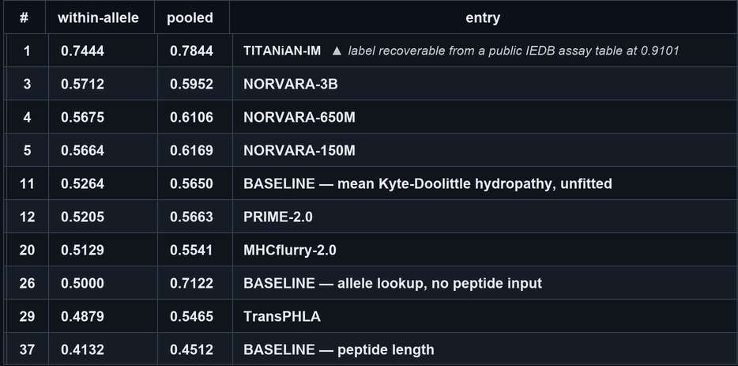

<div align="center">

# EpiGauge

A shared instrument for T-cell epitope immunogenicity prediction — one estimator, every
contamination mapped, every baseline shipped, so a result means the same thing wherever it is read.

[](https://doi.org/10.5281/zenodo.24222640)
[](https://github.com/norvara-therapeutics/epigauge/releases)
[](https://github.com/norvara-therapeutics/epigauge/actions/workflows/ci.yml)
[](https://github.com/norvara-therapeutics/epigauge/actions/workflows/pages.yml)
[](LICENSE)
[](pyproject.toml)

### 📊 [Infectious leaderboard](https://norvara-therapeutics.github.io/epigauge/) · [Neoantigen leaderboard](https://norvara-therapeutics.github.io/epigauge/neoantigen)



</div>

---

## Why this exists

Right now, published AUROCs for this task run from 0.47 to 0.85 and almost none of them can be
compared — different estimators, contaminated test sets, margins smaller than the noise floor. When
the ruler belongs to whoever is being measured, a field cannot correct itself, and it has not.

These predictions feed vaccine design and cancer immunotherapy. People will eventually act on them.
So the instrument should be free, legible and in everyone's hands — including the hands of people
who want to prove us wrong.

---

EpiGauge makes published numbers comparable: one specified estimator, a contamination census per
row, and the baselines a method has to beat before its number means anything.

---

## The problem

**Three measured facts, each of which breaks a published comparison.**

**1. The estimator decides the winner.** Pooled and within-allele AUROC rank the same methods in
opposite orders on identical rows. An allele lookup *with no peptide input* scores **pooled 0.7122**
and **within-allele exactly 0.5000**. On a pooled leaderboard it places second. Papers rarely say
which estimator they used.

**2. The test sets are contaminated.** A public dataset and a published neoantigen benchmark are the
same 833-row table — same labels, 25 of 25 shared predictor columns byte-identical. A naive join
returns 0 of 833, because one file spells the allele `HLA-A*01:01` and the other `A0101`. Run
`python scripts/verify_contamination.py` and watch it happen.

**3. The margins are below the noise floor.** At n = 2,093 the minimum detectable paired difference
is **≈0.059–0.095** after source-protein clustering. Nearly every published margin is smaller.
Excluding flagged rows, the whole field sits between 0.47 and 0.54 — a spread narrower than the
instrument can resolve.

---

## What the benchmark is made of

**Read this before quoting any number from it.**

| set | rows | origin |
|---|---|---|
| `titanian_infectious` | 2,093 | the **T-SCAPE / TITANiAN test set**, Dryad CC0 |
| `titanian_neoantigen` | 833 | the **T-SCAPE / TITANiAN test set**, Dryad CC0 |
| `independent_composite` | 243 | IEDB-derived, assembled here |
| `itsndb` | 199 | Nibeyro et al. 2023 |
| `xmuimmu_noncanonical` | 138 | Science 2024 |
| `hbv_hlabc_screen` | 105 | Front Immunol 2025 |

**The two large arms are one group's published test set.** EpiGauge is a *reproducibility*
instrument: it lets anyone recompute the field's numbers under a stated estimator. Four properties
of these rows to carry with any figure:

- The **neoantigen arm is fully contained** in BigMHC's `im_test.csv`. Contaminated for anything in
  that lineage.
- The infectious arm is **71.1% positive** — not a natural prevalence, and it makes top-k metrics
  close to useless on it.
- **`study_id` is constant** across all 2,093 infectious rows, so study-level clustering is
  *unmeasurable*, not merely unmeasured.
- Row identity against the Dryad deposit **is** established: `test.zip` matches the sha256 Dryad
  publishes for it, and all seven shipped members are byte-identical to the deposit's. An earlier
  revision of this file inferred from file modification times that the local copies predated the
  deposit; that inference was wrong, because a zip archive preserves its members' mtimes.

A set nobody has trained on needs a prospective time-split against new IEDB curation. That is the
roadmap, not this release.

---

## Leaderboard at a glance

| # | within-allele | pooled | entry |
|---|---|---|---|
| 1 | 0.7444 | 0.7844 | TITANiAN-IM ⚠ *label recoverable from a public IEDB assay table at 0.9101* |
| **8** | **0.5264** | 0.5650 | **BASELINE — mean Kyte-Doolittle hydropathy, unfitted** |
| 9 | 0.5205 | 0.5663 | PRIME-2.0 |
| 17 | 0.5129 | 0.5541 | MHCflurry-2.0 |
| **23** | **0.5000** | **0.7122** | **BASELINE — allele lookup, no peptide input** |
| 26 | 0.4879 | 0.5465 | TransPHLA |
| **32** | **0.4132** | 0.4512 | **BASELINE — peptide length** |

32 ranked entries, and two more whose figures are withheld under a licence clause. The
benchmark's authors ran their own models on both arms and do not publish them here: their
score columns are not distributed, so no third party can recompute those figures or attach
an interval to them, and the instrument would not be auditing them on the terms it applies
to every other entry.

Ranked on within-allele; pooled is printed, never ranked on. Seven rows of 32 — and nearly
every gap is below the MDE, so read the column as a band, not an order.

**[Full leaderboard →](leaderboards/infectious.md)** · **[Neoantigen arm →](leaderboards/neoantigen.md)**

On the neoantigen arm **no published figure is above chance** — all 30 span 0.4309–0.5397 with 19
below 0.500, peptide length alone ranks first, and TITANiAN-IM falls from 0.7444 to 0.4827 once its
assay-table lookup covers 1.3% of rows instead of 100%.

An unfitted 1982 physicochemical scale places 8th, above PRIME-2.0, MHCflurry-2.0, MixMHCpred,
TransPHLA and seven BigMHC variants.

---

## Install

```bash
git clone https://github.com/norvara-therapeutics/epigauge
cd epigauge
pip install -e .
```

Zero runtime dependencies — the metric layer is standard library only, so it runs anywhere. A
reviewer with a bare interpreter reproduces both leaderboards, the stratum diagnostic, the
rank-reversal tables and the Ceiling-2 bracket and the refused deconvolution. Three analyses need an input this
package does not redistribute: the clustered intervals need the nine UniProt reference proteomes,
the contamination census needs the three upstream CSVs, and the MHCflurry column needs that
predictor installed. `supplementary/README.md` states which figure needs which.

```bash
epigauge list                                     # the row sets, their licences, what ships
epigauge leaderboard --set titanian_infectious    # reproduce the table above
epigauge score my_predictions.csv --set titanian_infectious
epigauge fixtures                                 # 102 regression fixtures
```

`my_predictions.csv` is two columns: `row_id` and `score`. You get back the stratified and pooled
estimators side by side, the stratum accounting, the chance bar, the MDE, and your position against
the baselines.

[Quickstart](docs/QUICKSTART.md) · [Metrics](docs/METRICS.md) · [Submitting](docs/SUBMITTING.md) ·
[Contamination](docs/CONTAMINATION.md)

---

## EpiGauge ships no new predictor, deliberately

Five independent arms — a capacity ladder, a 175-config gate study, better-labelled data, seven
positional representations, and a 150M → 3B backbone ladder — found no architecture, representation
or scale that moves external transfer. In-distribution cross-validation on a benchmark's own labels
reaches 0.6125. Meanwhile independent references **disagree on 55.0% of multiply-measured epitopes**,
capping attainable AUROC at **0.9119**, with **0.6230** not excluded, on the 8.96% of units where
disagreement is observable at all.

The useful contribution is not another model. It is the instrument that says whether anyone's model
is real.

## Status

**Released, v0.1.4.** 102 regression fixtures pass.

## Citation

Archived on Zenodo. The concept DOI always resolves to the current version; cite the
version DOI when a figure needs to be reproducible against the exact release it came from.

```bibtex
@software{epigauge,
  author    = {Ribeiro, Ryan},
  title     = {{EpiGauge}: a measurement instrument for class-I T-cell
               epitope immunogenicity prediction},
  year      = {2026},
  publisher = {Zenodo},
  version   = {v0.1.4},
  doi       = {10.5281/zenodo.24228708},
  url       = {https://doi.org/10.5281/zenodo.24228708}
}
```

| | DOI |
|---|---|
| All versions | [10.5281/zenodo.24222640](https://doi.org/10.5281/zenodo.24222640) |
| v0.1.1 | [10.5281/zenodo.24222641](https://doi.org/10.5281/zenodo.24222641) |
| v0.1.2 | [10.5281/zenodo.24223115](https://doi.org/10.5281/zenodo.24223115) |
| v0.1.3 | [10.5281/zenodo.24226052](https://doi.org/10.5281/zenodo.24226052) |
| v0.1.4 | [10.5281/zenodo.24228708](https://doi.org/10.5281/zenodo.24228708) |

Please also cite the upstream data sources listed in `benchmarks/*/NOTICE.md`.

## License

Code MIT (see `LICENSE`). Shipped data is CC BY 4.0 or
CC0 per set, with the ITSNdb slice segregated under its own notice — see `benchmarks/*/NOTICE.md`.
